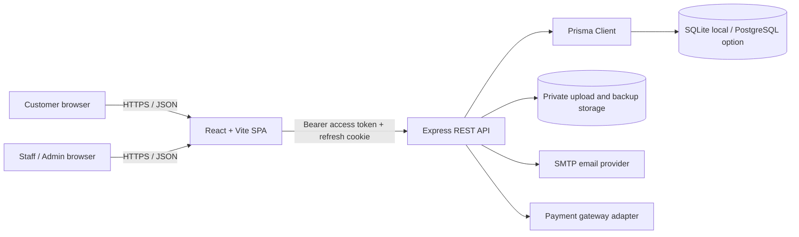
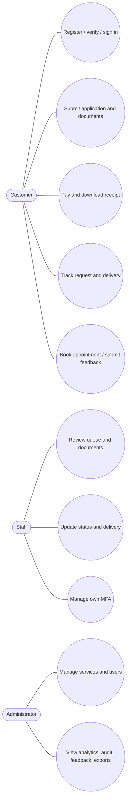
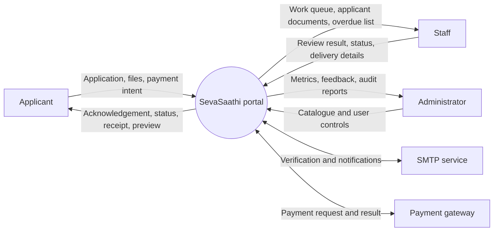
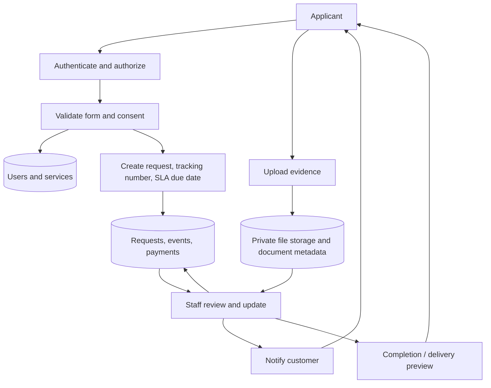
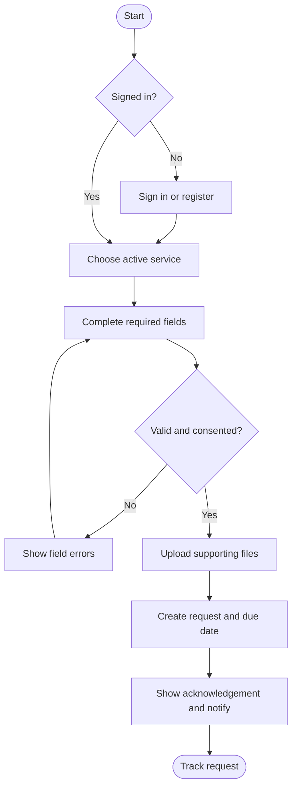
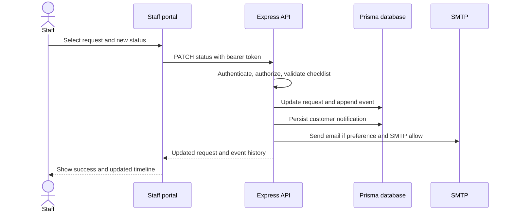

# SevaSaathi — MCA project report outline

Use this document as a report scaffold. Replace bracketed fields with the student's own details and verify each implementation statement against the submitted source. This application is an academic demonstration and is not a government service provider.

## Title page

- **Project:** SevaSaathi — Digital Service Request and Tracking Portal
- **Submitted by:** [Student name and enrollment number]
- **Programme:** Master of Computer Applications
- **Institution / department:** [Institution]
- **Guide:** [Guide name]
- **Academic year:** [Year]

## Abstract

SevaSaathi is a web application prototype for submitting service requests, uploading supporting documents, tracking status, handling payments, booking appointments, and coordinating staff review. It provides role-based customer, staff, and administrator views. The implementation uses a React single-page application, an Express API, Prisma ORM, and SQLite for local development, with an optional PostgreSQL schema. Security controls include hashed passwords, short-lived access tokens, rotating refresh tokens, role checks, rate limits, encrypted Aadhaar storage, private uploads, audit events, and optional authenticator-based staff MFA. Completion previews and seeded records are fictional samples and are explicitly not official documents.

## Problem statement and objectives

Paper-based or disconnected service workflows make it difficult for an applicant to see request progress, understand missing documents, and contact the responsible desk. The project demonstrates a shared portal that records submissions and status history and gives staff a queue for review. Objectives are to provide guided forms, secure document handling, request tracking, payments and receipts, appointments, staff/admin tools, and operational reporting.

## Scope and limitations

The project demonstrates workflows using fictional sample data. Government integrations, official certificate issuance, Aadhaar/PAN authority functions, SMS, production payment settlement, legal identity verification, and real courier fulfillment are outside the implemented scope. Email depends on SMTP configuration; payment processing depends on configured gateway credentials or the demo flow. This prototype is not suitable for real identity data without a formal security, privacy, and operational review.

## Requirements

### Functional

1. Register, verify email, sign in, reset password, manage profile, and end sessions.
2. Browse active services and submit dynamically validated requests with consent.
3. Upload required evidence; view private documents when authorized.
4. Track status events, due dates, completion previews, and delivery progress.
5. Record payment state and provide receipts for eligible paid requests.
6. Book appointments and show them in staff operational views.
7. Let staff review applications, update statuses, and record delivery actions.
8. Let administrators manage services/users, view metrics, feedback, audit records, and exports.

### Non-functional

- Role-aware API access, password hashing, encrypted sensitive values, validated uploads, rate limits, and generic production errors.
- Responsive interface, keyboard-visible focus, persistent light/dark preference, and English/Hindi/Marathi navigation labels.
- Local development and repeatable isolated backend tests.

## Architecture



The browser presents forms and status views. Express routes validate and authorize requests, services implement the application rules, and Prisma provides relational persistence. Sensitive Aadhaar fields are encrypted before persistence; document content is kept in private storage and exposed through authorized endpoints.

## Use-case diagram



## Data-flow diagrams

### Context (Level 0)



### Request processing (Level 1)



## Entity relationship diagram

```mermaid
erDiagram
  USER ||--o{ REQUEST : submits
  SERVICE ||--o{ REQUEST : categorizes
  REQUEST ||--o{ DOCUMENT : contains
  REQUEST ||--o| PAYMENT : paid_by
  REQUEST ||--o{ REQUEST_EVENT : records
  REQUEST ||--o| FEEDBACK : receives
  USER ||--o{ APPOINTMENT : books
  SERVICE ||--o{ APPOINTMENT : schedules
  USER ||--o{ NOTIFICATION : receives
  USER ||--o{ REFRESH_TOKEN : owns
  USER ||--o{ AUDIT_LOG : performs
  USER { string id PK; string email UK; string role; boolean active; string fullName; string phone }
  SERVICE { string id PK; string slug UK; string name; int feePaise; int expectedProcessingDays; boolean active }
  REQUEST { string id PK; string trackingNumber UK; string userId FK; string serviceId FK; string status; datetime dueAt }
  DOCUMENT { string id PK; string requestId FK; string storedName UK; string mimeType; int size }
  PAYMENT { string id PK; string requestId FK; string status; int amountPaise; string receiptNumber UK }
  REQUEST_EVENT { string id PK; string requestId FK; string type; string status; datetime createdAt }
  FEEDBACK { string id PK; string requestId FK; string userId FK; int rating }
  NOTIFICATION { string id PK; string userId FK; string title; datetime readAt }
  APPOINTMENT { string id PK; string userId FK; string serviceId FK; string date; string slot }
  REFRESH_TOKEN { string id PK; string userId FK; string tokenHash UK; datetime expiresAt }
  AUDIT_LOG { string id PK; string actorId FK; string action; datetime createdAt }
```

## Activity diagram — submitting a request



## Sequence diagram — staff status update



## Modules and data dictionary

| Module | Responsibility |
|---|---|
| Authentication | Registration, email verification, password reset, sessions, staff TOTP |
| Catalogue | Active service discovery and administrator editing |
| Applications | Dynamic validation, tracking identifiers, event timeline, completion checks |
| Documents | Private upload, metadata, MIME/signature validation, access control |
| Payments | Payment state, gateway/demo flows, receipt generation |
| Appointments | Slot availability, booking, staff queue |
| Notifications | Persisted in-app inbox, unread state, configured email delivery |
| Administration | User/service controls, analytics, feedback, audit views, exports |

| Entity | Important attributes | Purpose |
|---|---|---|
| User | `email` (unique), `passwordHash`, `role`, `active`, `emailVerifiedAt`, `totpEnabled` | Identity, access role, account and verification state |
| Service | `slug` (unique), `feePaise`, `expectedProcessingDays`, `active`, JSON strings `requiredDocuments` and `formSchema` | Configurable service catalogue and dynamic form rules |
| Request | `trackingNumber` (unique), `userId`, `serviceId`, `status`, `formData`, `aadhaarEncrypted`, `amountPaise`, `dueAt` | Customer application and processing state |
| Document | `requestId`, `storedName` (unique), `mimeType`, `size`, `kind` | Private file metadata; bytes stay in storage |
| Payment | `requestId` (unique), `status`, `amountPaise`, `receiptNumber` | Payment outcome and receipt identity |
| RequestEvent | `requestId`, `type`, `status`, `note`, `createdAt` | Append-only application timeline events |
| Feedback | `requestId` (unique), `userId`, `rating`, `comment` | One customer rating per request |
| Notification | `userId`, `title`, `message`, `link`, `readAt` | Per-user notification inbox |
| Appointment | `userId`, `serviceId`, `date`, `slot`, `status` | Scheduled service visit |
| RefreshToken | `userId`, `tokenHash` (unique), `expiresAt`, `revokedAt` | Rotating, revocable browser session token record |
| AuditLog | `actorId`, `action`, `targetType`, `targetId`, `createdAt` | Administrative/security event history |
| Counter | `name`, `value` | Atomic tracking/receipt number sequences |

Amounts are stored as integer paise. Dates are persisted as timestamps except appointment days, which are ISO date strings. JSON form values and service schemas are stored as serialized JSON strings in this prototype.

## Security and privacy design

- Passwords are stored as salted bcrypt hashes; passwords and raw refresh tokens are not persisted in plaintext.
- Access is checked server-side using authenticated user identity and role middleware. UI route hiding is not an authorization boundary.
- Aadhaar values are encrypted before storage and masked in response payloads. Encryption keys must be unique, private, and backed up separately.
- Uploads are limited by type, size, count, signature checks, and request ownership; storage is not web-public.
- Login and API calls are rate-limited; schemas validate input and the app applies baseline HTTP security headers.
- Error responses avoid stack traces and private field contents. Audit records should not contain secret values.
- Production use requires HTTPS, secure secret management, tested backups, configured mail/payment providers, retention decisions, and privacy/legal review.

## Test strategy

Backend integration tests run against a unique temporary SQLite database. Utility tests check schema normalization, sensitive-value encryption, and RFC 6238 TOTP behavior. The manual 40-case checklist is in [`TEST_CASES.md`](TEST_CASES.md). Before submission, record actual browser/device/version, test data, date, outcome, and defects fixed; do not claim unexecuted cases as passed.

## Installation and user manual

See the root [README](../README.md) for local setup, seeded demo accounts, environment variables, Docker, and troubleshooting. Customer flow: register and verify → choose service → complete fields/consent → upload required files → pay if applicable → follow timeline → provide feedback after completion. Staff flow: sign in → review queue and evidence → update status/checklist → record dispatch/delivery. Admin flow: manage service catalogue and accounts → review analytics/feedback/audit → export reports.

## Results, conclusion, and future work

Expected demonstration result is a traceable request lifecycle with persisted user-visible events, scoped staff/admin functions, and downloadable demo artifacts. Add screenshots of the actual app at the stage screenshots are taken. Possible future work includes automated email/SMS delivery integration, localization of remaining page copy, accessibility audit, production PostgreSQL migration management, object storage, formal deployment hardening, and authority-approved integrations.

## References and appendices

- React documentation: https://react.dev/
- Express documentation: https://expressjs.com/
- Prisma documentation: https://www.prisma.io/docs
- OWASP Cheat Sheet Series: https://cheatsheetseries.owasp.org/
- RFC 6238, TOTP: https://www.rfc-editor.org/rfc/rfc6238
- Appendices: API reference (`/api/docs`), Postman collection (`postman/SevaSaathi.postman_collection.json`), and manual test list (`TEST_CASES.md`).
